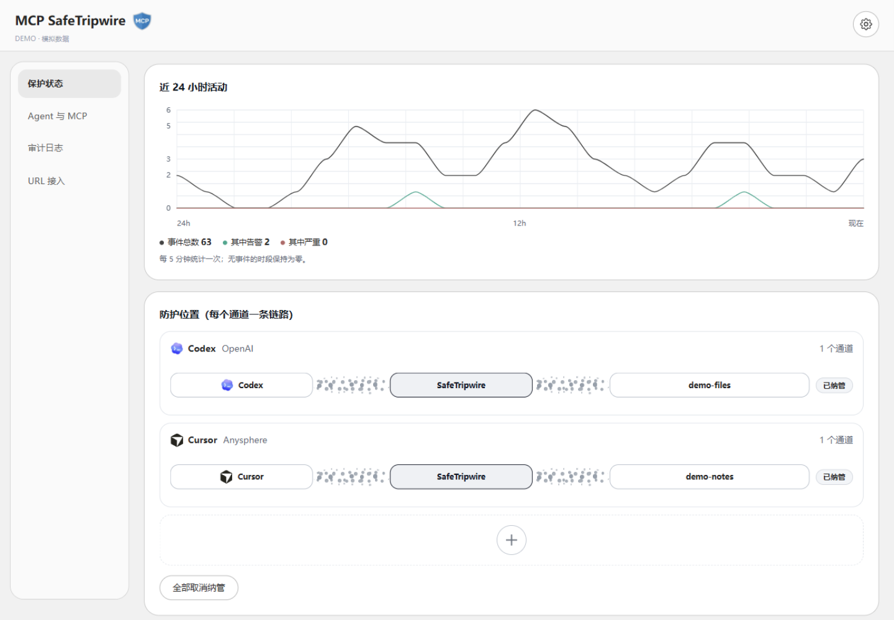
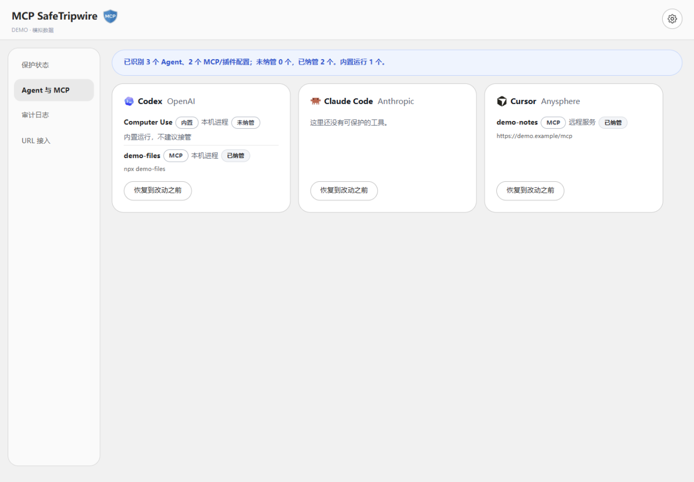

<p align="center">
  
</p>

<div align="center">

# MCP SafeTripwire · MCP 安全绊线

**Windows 桌面应用 · 在 Agent 与 MCP 之间加一道可检查的绊线**

[下载安装程序](https://github.com/luke0485/mcp-safetripwire/releases/latest/download/MCP-SafeTripwire-Setup.exe) · [便携版 ZIP](https://github.com/luke0485/mcp-safetripwire/releases/latest/download/MCP-SafeTripwire-windows-x64.zip)


</div>



*保护状态：24 小时活动、通道链路和当前模式。*



*Agent 与 MCP：内置运行单独标记；MCP / 插件统一盘点；纳管状态一目了然。*

## 它是什么

SafeTripwire 是一个 Windows 本地安全代理。它把 Agent 的 MCP 连接接到自己的检查器，记录工具清单、调用参数和审计事件，并在保护模式下拒绝命中规则的请求。

它不依赖额外 LLM，不需要云端账号；只有**经过 SafeTripwire 的通道**才会被检查和拦截。

## 主要能力

| 能力 | 说明 |
| --- | --- |
| 通道接入 | 本地 stdio 一键纳管；检测到的 HTTP MCP 自动生成 `127.0.0.1` 中转并改写配置，原配置先备份 |
| 工具清单指纹 | 覆盖名称、标题、描述、输入/输出 schema、annotations 与 `_meta`；变化可触发提醒或拦截 |
| 静态检查 | 检查工具描述、schema、annotations、`_meta` 和调用载荷中的可疑模式 |
| 黑名单 | 工具名、参数里的域名引用；域名匹配包含子域名 |
| 行为基线 | 正常调用积累至少 20 次后人工冻结；之后的新地址/新字段可按设置提醒或拦截 |
| 两种模式 | **观察模式**只记录和提醒；**保护模式**对已纳管通道执行拦截 |
| 审计 | JSONL 哈希链、轮转保留上一代链头、24 小时活动视图 |
| 桌面体验 | WinForms + WebView2 原生窗口；无地址栏；关闭面板后托盘后台运行 |
| 设置 | 右上角齿轮；语言、浅色/深色/跟随系统；设置页左上角返回 |

Agent 目录包含 **58 个条目**和 **30 个配置适配器**；自动发现、手动指定配置和 URL 接入是三种不同层级。详见 [Agent 覆盖说明](docs/AGENT-COVERAGE.md)。

## 安装与接入

1. 从 [Releases](https://github.com/luke0485/mcp-safetripwire/releases/latest) 下载 `MCP-SafeTripwire-Setup.exe`，双击安装。无需管理员权限，无需安装 Node.js。
2. 从桌面快捷方式打开应用。托盘会保持后台运行。
3. 打开 **Agent 与 MCP**，查看检测到的 Agent 和配置；选择要保护的通道。
4. 本地 stdio 通道点击“纳入防护”；检测到的 HTTP 通道会自动生成中转并改写地址。重启对应 Agent 使配置生效。
5. 先使用 **观察模式** 确认真实调用，再切换到 **保护模式**。

模式切换会弹应用内确认框；确认后只更新当前页，不重载页面、不跳回顶部。

## URL 接入

`URL 接入` 只用于**无法自动识别的 MCP**。已检测到的 HTTP MCP 会在页面直接列出一键接入，不需要手填地址。

手动添加是分步表单：名称 → MCP 地址 → 创建中转 → 复制本机地址。它不会赋予不支持 MCP 的产品额外能力。

## 安全边界

- 看到 Agent 图标不等于已受保护；只有“已纳管”的通道经过 SafeTripwire。
- 本机中转固定使用 `127.0.0.1`，不会在 `localhost`、`::1` 和 IPv4 之间切换。
- 云端 Agent、远程电脑上的 Agent、没有可读本地配置且没有 MCP URL 的产品，本机无法自动保护。
- 内置运行（例如 Codex 的 Computer Use）会标记为“内置”，不建议接管。
- 观察模式不拦截；保护模式也只覆盖经过 SafeTripwire 的通道，不是全局防火墙。
- 审计记录的是检查所需的信息，不应被当作完整取证镜像。

## 验证

- 自动化测试：**275 项全部通过**
- 生产依赖审计：`npm audit --omit=dev` → **0 个已知漏洞**
- 构建：主程序、WebView2 面板、便携 ZIP、安装程序
- 脚本检查：JS 语法 + PowerShell 解析通过


## 下载文件

- `MCP-SafeTripwire-Setup.exe`：推荐，安装到当前用户目录，创建桌面快捷方式和卸载入口
- `MCP-SafeTripwire-windows-x64.zip`：便携版，解压后运行 `Start MCP SafeTripwire.cmd`
- `SHA256SUMS.txt`：校验摘要

程序未签名；若 Windows 提示未知发布者，请先核对下载来源和 SHA-256。

## 开发

```powershell
npm ci
npm test
npm run doctor
node src/cli.js console
```

```powershell
./tools/build.ps1 -SkipInstall
./tools/package-release.ps1
./tools/build-installer.ps1
```

构建产物在 `dist/`，发布流程见 [docs/RELEASING.md](docs/RELEASING.md)。

## English

MCP SafeTripwire is a Windows-first, LLM-free security broker for Model Context Protocol traffic that is explicitly routed through it. It sits between an Agent and its MCP server, keeps a reviewed fingerprint of the tool surface, scans tool metadata and call arguments, applies tool and domain blocklists plus frozen behaviour baselines, and writes a hash-chained local audit log. Two modes keep rollout predictable: Observe records and notifies without blocking; Protect enforces the configured rules for enrolled channels. The application installs per user, runs as a native WebView2 panel with a tray process, keeps local relay addresses on `127.0.0.1`, and does not intercept traffic that never passes through it. It is not a global firewall, does not protect cloud-only or unconfigured Agents, and is not a substitute for host hardening or endpoint security.

## 作者与协作 / Credits

**作者 / Author：luke0485**

**AI 协作模型 / AI collaborators：DeepSeek V4.1 Flash、GPT6.1sol**

## 许可证

项目代码采用 [MIT License](LICENSE)。第三方 Agent 名称、商标和图标属于各自权利人，不因本项目的 MIT 许可证转授其商标权；图标来源见 [assets/README.md](assets/README.md)。
