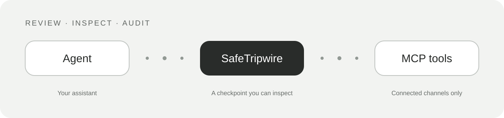

<p align="center">
  
</p>

<div align="center">

# MCP SafeTripwire · MCP 安全绊线

**MCP 安全绊线 · 作者 [luke0485](https://github.com/luke0485)**

[官方仓库 / Official repository](https://github.com/luke0485/mcp-safetripwire)

**让 Agent 继续工作，让 MCP 多一道检查。**

An inspectable security broker between your Agent and its MCP tools.


[](https://github.com/luke0485/mcp-safetripwire/actions)


[快速上手](#快速上手) · [保护什么](#保护什么) · [实测结果](#实测结果) · [开发与测试](#开发与测试) · [路线图](#路线图)

[**下载 Windows 安装程序**](https://github.com/luke0485/mcp-safetripwire/releases/latest/download/MCP-SafeTripwire-Setup.exe) · [便携版 ZIP](https://github.com/luke0485/mcp-safetripwire/releases/latest/download/MCP-SafeTripwire-windows-x64.zip) · [查看构建状态](https://github.com/luke0485/mcp-safetripwire/actions)
</div>



Agent 能调用工具，也可能遇到被替换的工具清单、可疑的工具描述或不该出现的调用参数。SafeTripwire 在 **已接入的 MCP 通道**中加入检查与审计，让你先看清变化，再决定是否阻断。

支持 **Windows**，Mac 和 Linux 版本将在后续推进。

由 **luke0485** 独立维护的开源 MCP 安全工具，包含工具投毒检查、工具清单完整性检查、行为基线、黑名单、主动阻断和审计日志。

Open-source Model Context Protocol (MCP) security for Windows: tool poisoning checks, manifest integrity, behavior baselines, blacklists, request blocking, and audit logging. Maintained by **luke0485**, GitHub account **luke0485**.

## 看得见的保护


*界面演示采用模拟数据，不代表本机流量或实际拦截统计。每个 MCP 一条通道；同一 Agent 的多个 MCP 会显示在同一组中。*


*先观察、再确认可信行为；普通用户可从默认选项开始，自定义工具和域名黑名单按需展开。*

## 保护什么

| 能力 | 你能得到什么 |
| --- | --- |
| 工具清单指纹 | 核对并批准工具清单；指纹覆盖名称、标题、描述、输入/输出 schema、annotations 与 `_meta`，后续变化会被发现，在保护模式下拒绝相关调用 |
| 静态规则检查 | 检查工具名称、标题、描述、schema、annotations 与 `_meta`，以及调用载荷中的已知可疑模式，不依赖额外 LLM API |
| 工具 / 域名黑名单 | 检查工具名和参数里的域名引用，匹配域名时包含其子域名 |
| 行为基线 | 记录放行调用；每个工具至少 20 次样本后，人工确认冻结正常行为，可提醒或阻断新地址引用及可选的新字段 |
| 审计与状态 | 中英文简要说明、活动趋势、通道状态、哈希链一致性检查；轮转时保留上一代链头 |
| 本机与 HTTP MCP | stdio 与支持的 HTTP / SSE 路由共用检查器；每个路由可单独指定阻断姿态 |
| 诱饵与金丝雀 | 保护模式下加入诱饵工具；stdio 通道获得每个安装随机生成的 `TRIPWIRE_CANARY` 环境值，外发时会被拦截 |
| 本机旁路观察 | 记录裸 TCP 通道；`--protect` 必须提供 `--allow` 名单，并且只允许回环监听 |
| 原生桌面面板 | WinForms + WebView2 原生窗口，不是浏览器标签页；无地址栏/标签栏，关闭窗口后托盘继续在后台运行 |

Agent 目录包含 **58 个条目**，其中 **30 个配置适配器**支持默认位置读取；可自动发现或手动接入。详见 [Agent 覆盖说明](docs/AGENT-COVERAGE.md)。


## 最新功能完善

- **每次连接都先核验**：保护模式下，新连接先核验已批准的工具清单，再放行清单内的工具。
- **清单变化会真正告警**：疑似 rug-pull、清单未核验和审计链异常保持 `critical`，会进入托盘通知和 24 小时告警计数。
- **更完整的指纹**：名称、标题、描述、输入/输出 schema、annotations 与 `_meta` 都进入 SHA-256；对象键序不影响结果，避免等价 schema 的误报。
- **审计链更结实**：单条记录超过 64 KiB、进程重启或日志轮转都不会再切断链；轮转后的第一条记录链接到上一代链头。
- **阻断姿态不会被静默覆盖**：HTTP 路由显式设置的 `posture` 优先于全局模式；`serve` / `bridge` 绑定失败会非零退出，不再显示“已启动”却没监听。

- **界面与入口**：左侧为 **Agent 与 MCP / 审计日志 / URL 接入**，右上角齿轮进入设置（语言、浅色/深色/跟随系统）；观察/保护模式切换前会弹应用内确认框，确认后只更新当前页，不闪屏、不跳回顶部。内置 Computer Use 会单独标记为“内置”，不建议接管。
- **固定本机地址**：控制台和本地 MCP 中转固定使用 `127.0.0.1`，不会在 `localhost`、`::1` 和 IPv4 之间切换，避免客户端指向不同回环地址。
- **原生桌面面板**：新增 WinForms + WebView2 窗口（`dist\MCP-SafeTripwire-Panel.exe`），不再用 Edge 的应用窗口打开控制台；有标题栏、图标和任务栏入口，没有地址栏/标签栏。WebView2 Runtime 随 Edge 安装在 Windows 10/11 上，通常无需额外安装。
- **登录链路更短**：浏览器只拿到一次性、5 分钟有效的登录码，长期 token 不再进入浏览器命令行或历史记录。
- **桥接更保守**：`--protect` 必须先做同步进程校验，未识别进程直接拒绝；默认只听回环，原始代码默认不写入审计（需要时用 `--log-code`）。
- **金丝雀真的会放置**：stdio 子进程通过 `TRIPWIRE_CANARY` 获得每个安装随机的测试秘密，只有把它带进工具参数才会触发拦截。
- **资源上限**：工具清单超过 1000 个视为异常，交叉引用扫描有上限；调用参数键和目的地写入审计时也会截断。

### Recent capability improvements

Each new connection verifies its approved tool manifest before calls are allowed in blocking mode. Rug-pull, unverified manifests and audit-chain breaks stay critical and reach the tray. The pinned identity now covers title, description, input/output schemas, annotations and `_meta`, with recursively sorted keys. Audit records larger than 64 KiB and log rotation no longer break the chain. Explicit HTTP route postures win over the global mode, and bind failures exit nonzero. The console opens in a native WinForms + WebView2 panel instead of an Edge app window, and the browser receives a single-use five-minute login code instead of the long-lived token. The TCP bridge requires an allowlist for `--protect`, listens on loopback only, and does not store raw code unless `--log-code` is set. stdio servers receive a per-install `TRIPWIRE_CANARY`. Manifests above 1000 tools are rejected.

## 快速上手

1. 在本仓库 **Releases** 下载 `MCP-SafeTripwire-Setup.exe`，双击安装（不需要管理员权限）。安装程序会创建桌面快捷方式，并登记“应用和功能”里的卸载入口；也可以下载 `MCP-SafeTripwire-windows-x64.zip` 作为便携版。
2. 从桌面快捷方式打开 **MCP SafeTripwire**。无需另外安装 Node.js；面板使用系统已有的 WebView2 Runtime（Windows 10/11 随 Edge 提供）。
3. 点击添加，选择 Agent，检查识别到的 MCP 通道，再接入需要保护的通道。自动改写配置前会保留备份。
4. 重启对应 Agent，让配置生效；核对工具清单并批准可信通道。
5. 先使用 **观察模式**了解正常调用，随后按需要启用 **保护模式**。

**注意：看到 Agent 图标不代表已经受到保护。** 只有经过 SafeTripwire 的 MCP 请求才会检查；观察模式通常只记录、不拒绝请求，显式拒绝策略另有优先级。行为基线应从可信操作中学习，不能盲目批准未知调用。开启保护模式后，后台发现新通道时会自动接入并先备份配置（不逐通道弹窗确认）；不希望自动改写时，请先保持观察模式并手动接入。

配置路径不在默认位置时，可手动指定配置文件。无法自动读配置的产品，只有在其支持自定义 MCP 时才能手动接入；“URL 接入”页面只用于无法自动识别的 MCP；已检测到的 HTTP MCP 会在该页面直接显示一键接入，不需要手填地址。不会自动赋予不支持 MCP 的产品相关能力。

Windows 程序未签名，不需要购买商业签名才能使用。若系统提示“未知发布者”，核对官方来源后可选择“更多信息 → 仍要运行”（系统允许时）。下载页提供 `SHA256SUMS.txt` 校验文件。

## 实测结果

**已通过 Windows 10 + WorkBuddy 接入与调用试验，检测和审计正常运行。** 20 项离线模拟安全检查全部通过，覆盖黑名单、行为基线、工具投毒、信任叛变、清单篡改和 HTTP 请求校验。

**接入通道 → 重启 Agent → 批准可信清单 → 开启保护。** 观察模式记录风险，保护模式拒绝命中的调用。

详细说明见 [安全政策](SECURITY.md) 和 [检测说明](docs/DETECTION-LIMITS.md)。

## 开发与测试

建议使用 Node.js 24 和 Windows PowerShell。

```powershell
npm ci
npm test
npm run doctor
node src/cli.js console
```

自动化测试覆盖规则、黑名单、行为基线、配置适配、管理接口、审计及 stdio / HTTP 传输，使用临时目录和模拟服务。

本次生产依赖检查 `npm audit --omit=dev` 为 0 个已知漏洞；仅表示检查时依赖数据库的结果。

构建可下载的 Windows 包：

```powershell
./tools/build.ps1 -SkipInstall
./tools/package-release.ps1
./tools/build-installer.ps1
```

Windows 发布工作流执行测试、构建，并生成校验摘要和构建证明。发布流程见 [发布说明](docs/RELEASING.md)。

## 路线图

- 持续进行 **安全审计、回归测试和功能补充**。
- 后续推进 **Mac 和 Linux 版本**。

欢迎提交使用反馈和功能建议；漏洞反馈请遵循 [SECURITY.md](SECURITY.md)。

## English

MCP SafeTripwire is a Windows-first, LLM-free security broker for MCP traffic explicitly routed through it. It combines reviewed manifest fingerprints, static rules, tool/domain blacklists, manually frozen behaviour baselines and local audit logging. Observe first, review trusted channels, then enable blocking when appropriate.

Successfully tested with WorkBuddy on Windows 10 for MCP integration, tool calls, detection and audit logging. All 20 offline simulated security checks passed. Continuous security audits, regression testing and feature additions will continue, with Mac and Linux versions planned.

## 作者与协作 / Credits

**作者 / Author：luke0485**

**AI 协作模型 / AI collaborators：DeepSeek V4.1 Flash、GPT6.1sol**

## 许可证

项目代码采用 [MIT License](LICENSE)。第三方 Agent 名称、商标和图标属于各自权利人，不因本项目的 MIT 许可证转授其商标权；图标来源见 [assets/README.md](assets/README.md)。
